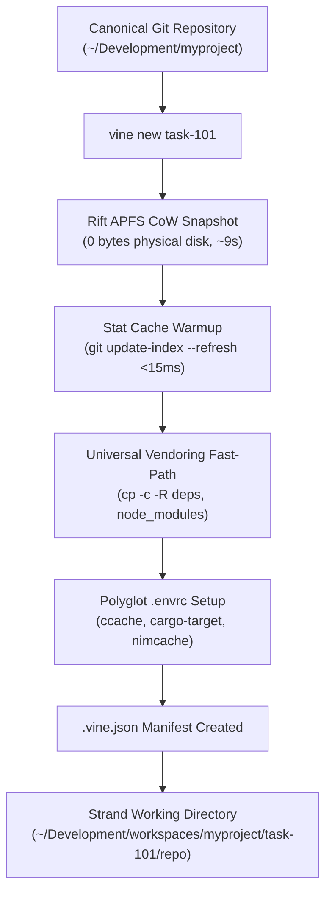

# Vine Strand Lifecycle & Virtualization Specification

> **Zero-Cost APFS Copy-on-Write Workspaces & Manifest Specification**  
> *A normative specification governing Strand directory layout, pre-flight checks, CoW vendoring fast-paths, `.vine.json` manifests, and collision detection.*

---

## 1. Overview & Architectural Role

Vine provisions instantaneous, zero-cost isolated working environments called **Strands** using APFS Copy-on-Write (CoW) snapshots (`rift`). Strands allow dozens of autonomous coding assistants to work in parallel on the same codebase without mutating the canonical git tree, polluting the primary git index, or thrashing IDE file watchers.



---

## 2. Directory Layout & Isolation Invariant

To prevent recursive IDE indexing, infinite loops in find/grep, and git index contention, **all Strands live outside the canonical repository tree**:

```text
$HOME/Development/workspaces/<project>/<task-slug>/<repo>/
├── .git/                      # Local git working tree / submodule pointers
├── .vine.json                 # Uncommitted runtime strand manifest
├── .envrc                     # Polyglot cache normalizer
├── src/                       # Worktree source files
└── ...
```

<FORBIDDEN>
Zero Dirty Commits:
Never stage or commit '.vine.json' or workspace metadata into Git. Strand metadata must remain uncommitted and ignored in '~/.gitignore_global' or '.git/info/exclude'.
</FORBIDDEN>

---

## 3. Provisioning Protocol

### Step 1: Submodule Pre-Flight Check
Before cloning, Vine inspects the canonical repository for uninitialized submodules:
```bash
if git submodule status 2>/dev/null | grep -q '^-'; then
  echo "WARNING: Canonical repository has uninitialized submodules. Initialize first before cloning!"
fi
```

### Step 2: APFS Copy-on-Write Clone
1. **Repositories with Git Submodules (e.g. PebbleOS)**:
   Vine uses `rift create` for native APFS CoW cloning of the working tree and `.git/modules` in ~9s with 0 extra disk blocks.
2. **Monolithic Repositories without Submodules (e.g. Rhizo, Redis)**:
   Vine uses native `git worktree add <dir> -b <branch>` in ~280ms.

### Step 3: Stat Cache Warmup
Silences APFS inode change time (`ctime`) differences in $<15\text{ ms}$:
```bash
git -C "$STRAND_DIR" update-index --refresh >/dev/null 2>&1 || true
```

### Step 4: Universal APFS Vendoring Fast-Path
Pre-built dependency caches from the canonical repository are hardlinked or cloned via APFS CoW in $<80\text{ ms}$ without consuming physical disk space:
```bash
VENDORED_DIRS=("deps" "nimbledeps" "vendor" "node_modules" ".zig-cache")
for vdir in "${VENDORED_DIRS[@]}"; do
  if [ -d "$CANONICAL_REPO/$vdir" ] && [ ! -d "$STRAND_DIR/$vdir" ]; then
    cp -c -R "$CANONICAL_REPO/$vdir" "$STRAND_DIR/$vdir"
  fi
done
```

### Step 5: Python Virtual Environment (`.venv`) Policy
1. Inspects `$CANONICAL_REPO/.venv/pyvenv.cfg`.
2. **If `relocatable = true`**: Safely APFS clones `.venv`:
   ```bash
   cp -c -R "$CANONICAL_REPO/.venv" "$STRAND_DIR/.venv"
   ```
3. **If NOT relocatable**: Prevents blind-copying (to avoid mutating parent shebangs).
   - If `venv_policy = "recreate"`: Runs `UV_VENV_RELOCATABLE=1 uv venv "$STRAND_DIR/.venv"` (~12ms).
   - Otherwise: Prompts the operator.

---

## 4. `.vine.json` Runtime Manifest Schema

Every active strand maintains an uncommitted `.vine.json` manifest tracking its lifecycle state:

```json
{
  "$schema": "https://json-schema.org/draft/2020-12/schema",
  "title": "VineStrandManifest",
  "type": "object",
  "required": [
    "task_id",
    "project",
    "strand_path",
    "branch",
    "base_branch",
    "base_commit",
    "status",
    "created_at"
  ],
  "properties": {
    "task_id": { "type": "string" },
    "project": { "type": "string" },
    "strand_path": { "type": "string" },
    "branch": { "type": "string" },
    "base_branch": { "type": "string", "default": "main" },
    "base_commit": { "type": "string" },
    "status": {
      "type": "string",
      "enum": [
        "PROVISIONED",
        "IN_PROGRESS",
        "GATE_EVALUATING",
        "READY_FOR_WEAVE",
        "GATE_PASSED",
        "CONFLICTED",
        "GATE_FAILED",
        "WOVEN",
        "ORPHANED"
      ]
    },
    "gate_token": {
      "type": "object",
      "properties": {
        "token": { "type": "string" },
        "commit_sha": { "type": "string" },
        "verified_at": { "type": "string" }
      }
    },
    "created_at": { "type": "string" }
  },
  "additionalProperties": false
}
```

---

## 5. Multi-Strand Collision Detection (`vine collisions`)

When multiple agents implement features concurrently, they risk modifying the same source files, creating merge train pileups. Vine analyzes the active file footprint across all strands:

```bash
vine collisions
```
- Inspects `git diff --name-only <base_branch>...HEAD` across all active strands.
- Computes intersection matrices.
- Flags overlapping files before code is written, allowing the Lead Orchestrator to schedule distributed fencing locks (`rhizo lock <file_path>`).
