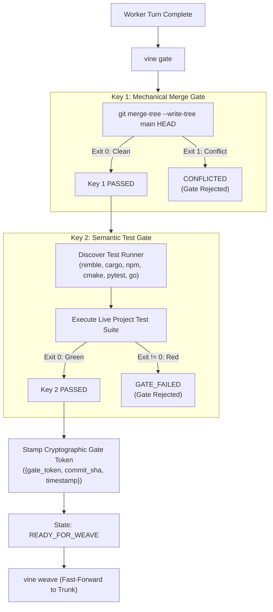

# Vine Two-Key Gate Specification

> **Deterministic Mechanical & Semantic Verification Gate**  
> *A normative specification eliminating the "Green Mirage" through dual-key verification, automated test runner discovery, and cryptographic gate tokens.*

---

## 1. The "Green Mirage" Problem & The Two-Key Solution

In autonomous multi-agent engineering, a branch may appear clean and mergeable according to `git merge-tree` while containing fatal semantic breakage (type errors, broken ABI contracts, test regressions). Conversely, tests might pass in isolation on an outdated base commit that cannot merge cleanly.

Vine eliminates this **Green Mirage** by enforcing the **Two-Key Gate**:



---

## 2. Key 1: In-Memory Mechanical Merge Gate

Key 1 executes a non-destructive, in-memory 3-way tree merge against the target base branch (default `main` or configured parent):

```bash
git merge-tree --write-tree "$BASE_BRANCH" HEAD
```

- **Exit 0**: The branch can be mechanically merged without conflict markers. The computed merge tree OID is captured.
- **Exit 1**: Conflicts detected. Vine marks the strand state as `CONFLICTED` in `.vine.json` and outputs conflicting file paths. The worker must resolve conflicts *inside the strand* before proceeding.

---

## 3. Key 2: Live Compiler & Test Suite Gate

Key 2 verifies semantic correctness by running the project's actual build and test suite inside the isolated strand directory.

### Automated Test Runner Discovery Cascade
If `--test-command` is not explicitly provided, Vine inspects the strand repository root and evaluates the discovery cascade:

| Precedence | Indicator File | Inferred Test Runner Command |
| :---: | :--- | :--- |
| **1** | `vine.toml` (`[gate] test_command`) | User-configured project test command |
| **2** | `CMakePresets.json` / `CMakeLists.txt` | `ctest --preset default` or `cmake --build build -t test` |
| **3** | `*.nimble` | `nimble test` |
| **4** | `Cargo.toml` | `cargo test` |
| **5** | `pnpm-lock.yaml` | `pnpm test` |
| **6** | `yarn.lock` | `yarn test` |
| **7** | `package.json` | `npm test` |
| **8** | `pyproject.toml` / `uv.lock` | `uv run pytest` |
| **9** | `go.mod` | `go test ./...` |
| **10** | `Makefile` | `make test` |

### Custom Test Command Override
Workers can provide explicit custom commands using the `--` POSIX separator or `--test-command`:
```bash
vine gate -- nimble test --verbose
vine gate --test-command "pytest tests/integration"
```

---

## 4. Cryptographic Gate Token Protocol

When both Key 1 and Key 2 exit with code 0:
1. Vine generates a cryptographic `gate_token` composed of:
   - `commit_sha`: Exact git commit SHA at the moment of verification.
   - `verified_at`: ISO 8601 UTC timestamp.
   - `token`: HMAC-SHA256 digest of `{commit_sha}:{verified_at}`.
2. The token is stamped into `.vine.json`.
3. The strand status transitions to `READY_FOR_WEAVE` (or `GATE_PASSED`).

### Weaving Invariant
`vine weave` checks that:
- `.vine.json` contains a valid `gate_token`.
- Current `HEAD` in the strand matches `gate_token.commit_sha`.
- If uncommitted changes exist or commits were added after `vine gate`, `vine weave` aborts with `ERR_GATE_TOKEN_STALE`.
