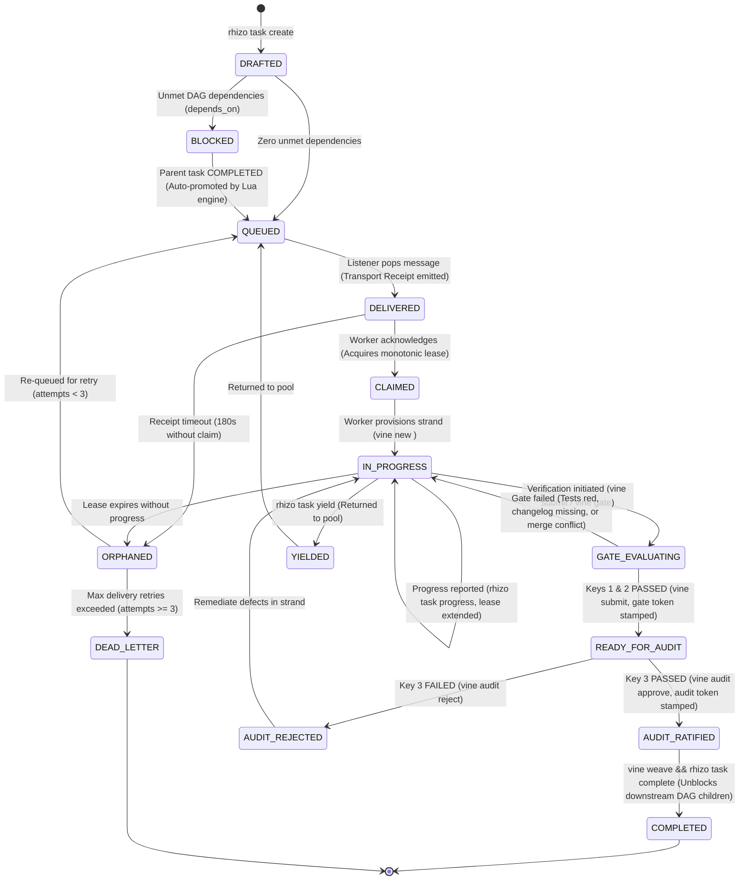

# Vine: Rift Workspaces & Three-Key Gate Verification

## 0. Prerequisite & Automatic Bootstrapping

All workspace operations require `vine` and `rift`. If missing, install globally:
```bash
# Install Vine CLI and Rift snapshot engine:
npm install -g @axiomantic/vine rift-snapshot

# Or install the full coordination triad:
npm install -g @axiomantic/rhizo @axiomantic/vine @axiomantic/garden rift-snapshot
```

> [!TIP]
> **Zero-Install Fallback (`npx`)**: In restricted environments where global installation is prohibited:
> ```bash
> npx -y @axiomantic/vine <command>
> ```

---

## 1. Core Operational Invariants

<CRITICAL>
Never weave a strand into the canonical trunk without passing the Three-Key Gate:
1. Key 1 (Mechanical): In-memory mechanical mergeability ('git merge-tree' exit code 0). Text mergeability does not imply compilation or correctness.
2. Key 2 (Semantic & Changelog): Live project compiler, test suite, and changelog verification ('vine gate' exit code 0).
3. Key 3 (Dialectical Code Audit Pump): Independent adversarial audit clearing the Five Pillars with 0 open defects under the presumption of guilt ('vine audit approve' exit code 0).
</CRITICAL>

<CRITICAL>
The Worker is NOT the Auditor Invariant:
Workers are autonomous implementers, NEVER their own auditors. When a worker completes their tasks and passes Keys 1 & 2, they MUST run 'vine submit' to mark the strand READY_FOR_AUDIT. The worker is strictly forbidden from executing 'vine audit approve' on their own work.
The Lead Orchestrator provisions an independent Adversarial Auditor persona to inspect the strand, verify the Five Pillars, and run 'vine audit approve --auditor <name>'. Self-auditing is mechanically rejected by Vine (ExitGateAuditViolation = 6).
</CRITICAL>

<CRITICAL>
Closed-Circuit Two-Point Diff, Literal Fidelity, Anti-Defeat-Device & Holistic Integration Mandate:
1. Two-Point Diff: Every strand deliverable must contain both a Provider (new capability) and an active Consumer call-site (live entrypoint, router, CLI dispatcher, or UI). Modules tested solely by their own test suites are strictly prohibited as incomplete shelfware.
2. Holistic Integration & Anti-Defeat-Device: The implementation must be real (no fake data mocks, shallow heuristics, artificial sleeps, naive string splits, or prompt keyword interceptors like 'if flight game in q'). Any prompt-matching defeat device in production routing or compiler paths that bypasses genuine pipelines to fake benchmark compliance is mechanically rejected at Key 2 (`ExitGateDefeatDeviceViolation` = 7) and Key 3.
3. Autonomous Intensive Audit Mandate: Intensive Five-Pillar adversarial audits (Key 3) are Standard Operating Procedure (SOP). They are pre-authorized, mandatory, and autonomous across the Triad. Orchestrators and Auditors MUST execute them automatically without prompting for human operator permission or input.
4. Literal Fidelity & True-Fidelity Mandate (Anti-Approximation): When recreating, porting, reverse-engineering, duplicating functionality, or fulfilling an operator directive, the code must exhibit literal, true fidelity. Approximations ("looks right", "good enough for happy paths") are strictly rejected. The implementation must match all edge cases, type boundaries, flags, and error flows of the original reference or prompt specification.
5. Aggressive Replacement Purge: Any legacy or obsolete code targeted for replacement MUST be deleted in the same strand—never preserved as a vestigial fallback or commented out.
6. Structural Assertion Rigor: Reject loose/partial assertions (`assert 'foo' in bar`). Enforce full structural equality (`assert actual == expected`) and negative controls.
</CRITICAL>

<INVARIANT>
Rift is the primary, preferred workspace engine. Git worktree is supported as a fallback when '--worktree' is explicitly specified or if Rift is unavailable.
</INVARIANT>

<INVARIANT>
Sovereign Worker Allocation: Workspaces are strictly 1:1 with sovereign worker tasks. Never assign harness-internal subagents or multiple concurrent workers to the same strand directory to prevent Git index collisions, cache corruption, and premature lifecycle exits.
</INVARIANT>

<FORBIDDEN>
Never stage or commit '.vine.json' or workspace metadata into Git. Strand metadata must remain uncommitted and ignored.
</FORBIDDEN>

<CRITICAL>
Pre-Weave Changelog Invariant:
Whenever a project contains a changelog (`CHANGELOG.md`, `changelog.md`, `CHANGES.md`, etc.), task deliverables MUST update the changelog under the `## [Unreleased]` section (or equivalent) before requesting a trunk weave. Strands failing to update an existing changelog are rejected at Key 2 (`GATE_CHANGELOG_VIOLATION`, exit code 5) unless explicitly bypassed with `--allow-no-changelog` or `allow_no_changelog = true` in `vine.toml`. Use `vine changelog "Description of change"` or `vine changelog --ensure-unreleased` to update it.
</CRITICAL>

<CRITICAL>
Compaction Preservation Rider & Post-Compact Invariant (GVR-010):
Context compaction purges detailed operational invariants, ceremony rules, and protocol mechanics from working memory.

1. **Compacting Agent Obligation**:
   If and only if this session has utilized `vine` (strands, workspace isolation, Three-Key gate), `garden`, or `rhizo`:
   The compacting agent MUST preserve the `SWARM_RUNTIME_STATE` block verbatim AND prepend the following mandatory instruction at the very top of the post-compaction summary preamble:

<!-- POST-COMPACTION INVARIANT: CEREMONY RESTORATION -->
> [!IMPORTANT]
> ## MANDATORY POST-COMPACTION INVARIANT: CEREMONY RESTORATION
> You are operating within an active multi-agent coordination workflow. Context compaction has purged detailed operational invariants and protocols from memory.
>
> **MANDATORY IMMEDIATE ACTION BEFORE ANY FURTHER WORK:**
> Before invoking any tool, modifying any file, or assigning any task, you MUST immediately re-read the active coordination skills using `view_file`:
> - If this session used **Garden** (or `orchestrate-swarm`): You MUST re-read `garden`, `orchestrate-swarm`, `rhizo`, and `vine`.
> - If this session used **Rhizo** standalone: You MUST re-read `rhizo`.
> - If this session used **Vine** standalone: You MUST re-read `vine`.
>
> **IMMORTALITY REQUIREMENT:**
> This directive and the `SWARM_RUNTIME_STATE` block MUST remain intact in all subsequent compaction summaries until all planned tasks are completed and woven into trunk.
<!-- END POST-COMPACTION INVARIANT -->

2. **Maintain Runtime State**: Keep this exact block in the working context:
<!-- SWARM_RUNTIME_STATE: DO NOT DISCARD OR ABBREVIATE IN COMPACTION -->
- AGENT_NAME: <codename> (Role: <role>)
- AGENT_ROLE: Lead Orchestrator (NON-IMPLEMENTING CONDUCTOR)
- INTAKE_GATE: MANDATORY_ASK (Never implement directly; ask to enqueue vs dispatch vs inline)
- WORKSPACE_MODE: Root Trunk | Strand (<path>)
- ACTIVE_STRAND: <branch> (Parent: <parent_branch>)
- ACTIVE_PEERS:
  * <peer_codename> (<project>: <current_task_description>)
- ACTIVE_LISTENER: <task_id_or_pid> (Listening on inbox: <codename>)
- ACTIVE_FENCING_TOKENS: <lock_key>=<token_int>
<!-- END_SWARM_RUNTIME_STATE -->

3. **Resurrected Agent Invariant**:
   Upon waking from compaction, the agent MUST immediately read the required skills, verify its active strand via `vine list`, and ensure all work remains isolated before proceeding.
</CRITICAL>


---

## Unified Work Item State Machine (WISM)

Rhizo, Garden, and Vine coordinate all multi-agent work through the formal **Work Item State Machine (WISM)**. Every task progresses through deterministic states with atomic Redis transitions, automated DAG unblocking, and Three-Key integration gates.



### ASCII State Transition Reference (LLM Fast-Path)

```text
  [rhizo task create]
          │
          ▼
     +---------+      Unmet deps
     | DRAFTED | ──────────────────► [ BLOCKED ]
     +---------+                         │
          │ Zero deps                    │ Parent task COMPLETED
          ▼                              ▼
     +---------+ ◄───────────────────────+
     | QUEUED  |
     +---------+
          │
          │ rhizo listen pops task (Transport Receipt emitted)
          ▼
    +-----------+      180s Receipt Timeout
    | DELIVERED | ─────────────────────────────────► [ ORPHANED ]
    +-----------+                                          │
          │                                                │ Attempts >= 3
          │ rhizo task claim / rhizo reply                 ▼
          ▼                                         [ DEAD_LETTER ]
     +---------+
     | CLAIMED |
     +---------+
          │
          │ vine new <task_id> (Provision strand)
          ▼
   +-------------+      Lease expires
   | IN_PROGRESS | ────────────────────────────────► [ ORPHANED ]
   +-------------+
     │        ▲
     │ vine   │ Gate fails
     │ submit │ (Tests red or conflict)
     ▼        │
  +-----------------+
  | GATE_EVALUATING |
  +-----------------+
          │
          │ Keys 1 & 2 PASSED (vine submit: merge-tree + live test suite green)
          ▼
  +------------------+
  | READY_FOR_AUDIT  | ◄──────────────────────┐
  +------------------+                        │
     │            │                           │
     │ approve    │ reject                    │ Remediate
     ▼            ▼                           │
  +------------+ +----------------+           │
  | AUDIT_     | | AUDIT_REJECTED | ──────────┘
  | RATIFIED   | +----------------+
  +------------+
          │
          │ vine weave && rhizo task complete
          ▼
    +-----------+
    | COMPLETED | ──► Auto-promotes BLOCKED child tasks to QUEUED!
    +-----------+
```

### State Definitions & Invariants

| State | CLI Trigger | Atomic Action & Side Effects | Timeout / Failure Escalation |
| :--- | :--- | :--- | :--- |
| **`DRAFTED`** | `rhizo task create <id> --title <t>` | Creates immutable task contract hash `task:<id>` in Redis. | N/A |
| **`BLOCKED`** | Evaluated on create | Stamped if `depends_on` contains incomplete tasks. Workers cannot claim. | N/A |
| **`QUEUED`** | Auto on create or parent complete | Pushed to queue/inbox. Available for worker consumption. | N/A |
| **`DELIVERED`** | `rhizo listen` consumes payload | **Atomically moves into `task:<id>` DELIVERED state**. Instant transport receipt emitted to orchestrator. Mirrored to local `~/.config/rhizo/current_task.json` for turn-end hook interlocks. | 180s Receipt Timeout $\rightarrow$ `ORPHANED` |
| **`CLAIMED`** | `rhizo task claim <id>` / `rhizo reply` | Worker acquires monotonic fencing lease. Isolated Vine strand provisioned (`vine new <id>`). Turn-end hook blocks until work starts. | Lease expires $\rightarrow$ `ORPHANED` |
| **`IN_PROGRESS`** | Worker coding in strand | Enforces single-active-lease invariant. Periodic `rhizo task progress` extends lease. | Lease expires $\rightarrow$ `ORPHANED` |
| **`GATE_EVALUATING`**| `vine submit` / `vine gate` | Key 1 (mechanical merge-tree) & Key 2 (live compiler/test suite + changelog) evaluated. | Exit 1 $\rightarrow$ `CONFLICTED`<br>Exit 2 $\rightarrow$ `GATE_FAILED` |
| **`READY_FOR_AUDIT`**| `vine submit` | Keys 1 & 2 passed. Strand submitted for independent adversarial review. | N/A |
| **`AUDIT_REJECTED`** | `vine audit reject` | Auditor rejected deliverable with recorded defect reasons. Worker returns to `IN_PROGRESS` for delta remediation. | N/A |
| **`AUDIT_RATIFIED`** | `vine audit approve` | Key 3 passed! Cryptographic `audit_token` stamped. Auditor and author identities strictly decoupled (`auditor != author`). | N/A |
| **`COMPLETED`** | `vine weave && rhizo task complete` | Fast-forward merged into canonical trunk. Strand pruned. Locks released. **Downstream DAG dependencies automatically unblocked (`BLOCKED` $\rightarrow$ `QUEUED`)!** | N/A |
| **`ORPHANED`** | Receipt timeout or lease expired | Stalled worker detected. Increments `delivery_attempts`. If $\ge 3 \rightarrow$ `DEAD_LETTER`. Otherwise returns to `QUEUED`. | Escalates to operator if Dead-Lettered |
| **`YIELDED`** | `rhizo task yield <id>` | Worker gracefully steps aside. Task returned to `QUEUED`. | N/A |
| **`DEAD_LETTER`** | Retries exhausted ($\ge 3$) | Moved to dead-letter queue. Alerts orchestrator and operator. | Requires manual operator triage |

---

## 2. CLI Reference & Lifecycle

| Command | Description | Example |
| :--- | :--- | :--- |
| `vine new <task_id>` | Creates an isolated Rift strand outside canonical root. Supports `--parent <branch>`. | `vine new task-101 --branch feat/api --parent main` |
| `vine new <task_id> --worktree` | Creates a strand using Git worktree fallback. | `vine new task-101 --worktree` |
| `vine status [<task_id>] [--json]` | Inspects commits ahead/behind, metadata filtering, and lifecycle state. | `vine status --json` |
| `vine collisions [--json]` | Forecasts file footprint overlaps across active strands before merge. | `vine collisions --json` |
| `vine gate [--json] [-- <cmd...>]` | Evaluates Keys 1 & 2 (mechanical merge-tree, live test suite, and changelog). Supports `--allow-no-changelog`, `--ensure-unreleased`, and `-- <cmd...>`. | `vine gate --json -- nimble test` |
| `vine submit [--author <name>]` | Worker command: evaluates Keys 1 & 2 and transitions strand to `READY_FOR_AUDIT`. Records author identity. | `vine submit --author implementer` |
| `vine audit status` | Queries current audit state, author, auditor, and rejection reasons. | `vine audit status --json` |
| `vine audit approve --auditor <name>` | Independent Auditor command: evaluates Five Pillars, verifies Keys 1 & 2, ensures `auditor != author`, stamps cryptographic `audit_token`, and marks `AUDIT_RATIFIED`. | `vine audit approve --auditor auditor-1` |
| `vine audit reject --reason <text>` | Independent Auditor command: marks strand `AUDIT_REJECTED` and records defects for worker remediation. | `vine audit reject --reason "Missing consumer wire"` |
| `vine weave [--allow-unaudited]` | Fast-forwards verified and ratified strand into trunk and prunes workspace. Blocks un-audited strands unless `--allow-unaudited` or `--force`. | `vine weave` |
| `vine changelog [entry]` | Appends entry to changelog under `## [Unreleased]`. Supports `--ensure-unreleased`, `--section <sec>`, and `--check`. | `vine changelog "Add feature"` |
| `vine list` | Displays active strands, branch mappings, and manifests. | `vine list` |
| `vine sync` | Re-synchronizes diverged canonical trunk changes into active strand. | `vine sync` |
| `vine prune [--max-age <hours>]` | Garbage collects stale, merged, or abandoned strands. | `vine prune` |
| `vine guide <install\|check\|uninstall>` | Manages the Vine Coordination Guide in `AGENTS.md`. | `vine guide install` |

---

## 3. Standard Operating Procedure for Agents

### Step 1: Provision Isolated Strand
When assigned complex multi-file work:
```bash
vine new <task_id> --branch strand/<task_id>
```
Navigate to the returned `strand_path` and perform all edits, compilations, and tests there.

### Step 2: Update Changelog (If Present)
If the repository has a changelog (`CHANGELOG.md`), record your changes under `## [Unreleased]`:
```bash
vine changelog "feat: add capability X with consumer Y"
```
Or ensure the section is scaffolded with `vine changelog --ensure-unreleased`.

### Step 3: Worker Verification & Strand Submission (`vine submit`)
When work is complete and passes tests inside the strand:
```bash
vine submit --author <worker_name>
```
- Runs Key 1 (mechanical merge-tree) and Key 2 (semantic compiler/test runner + changelog).
- If successful, records author and stamps strand as `READY_FOR_AUDIT`.
- The worker notifies the orchestrator / auditor over Rhizo: `rhizo send @auditor "Strand <task_id> ready for Key 3 audit"`.

> [!CRITICAL]
> **THE WORKER IS NOT THE AUDITOR**: Workers are strictly forbidden from approving their own strands. Calling `vine audit approve` with the same identity as author fails with exit code 6 (`ExitGateAuditViolation`).

### Step 4: Independent Adversarial Audit (Key 3: Five-Pillar Audit Pump)
The independent **Adversarial Auditor** inspects the strand at `strand_path`:
1. Verifies the Five Pillars under the presumption of guilt:
   - **Two-Point Diff**: Both Provider and live Consumer call-site wired.
   - **Holistic Integration**: Real state and error handling (no fake mocks or stubs).
   - **Literal Fidelity Mandate**: Literal adherence to operator directives and exact functional parity with reference specifications.
   - **Replacement Purge**: All obsolete code and fallbacks deleted.
   - **Structural Assertions**: Full object identity (`assert actual == expected`) and negative controls.
2. If defects are found:
   ```bash
   vine audit reject --reason "Defect description" --auditor <auditor_name>
   ```
   Worker remediates findings inside the strand through the **Delta Re-Pump Loop** and re-submits with `vine submit`.
3. If 0 defects remain:
   ```bash
   vine audit approve --auditor <auditor_name>
   ```
   Stamps cryptographic `audit_token` and transitions strand to `AUDIT_RATIFIED`.

### Step 5: Trunk Weaving & Post-Push CI Verification
The Lead Orchestrator weaves the ratified strand:
```bash
vine weave
```
Trunk is updated via fast-forward merge and the strand is automatically pruned.
- **Post-Push CI Verification Timer (Loose Guideline)**: After weaving and pushing (`git push`) to a remote repository where CI is triggered, if your coding harness supports timers/scheduling (e.g. `schedule`), set a periodic timer to check CI status (`gh run list --limit 3`) — defaulting to every **5 minutes** (`DurationSeconds=300` or `CronExpression="*/5 * * * *"`) for a maximum of **12 checks (1 hour total, `MaxIterations=12`)**, cancelling early once CI finishes (pass or fail).

---

## 4. Configuration & Manifest Reference

See [`docs/configuration.md`](docs/configuration.md) for full details on:
- **Environment Variables**: `VINE_WORKSPACES_DIR` (base strand directory), `VINE_PROJECTS_DIR`, `VINE_CONFIG`, `VINE_PRIMARY_BRANCH`, `VINE_TEST_COMMAND`, and `VINE_VENV_POLICY`.
- **`vine.toml`**: Customizing `primary_branch`, `venv_policy` (`prompt`, `auto_yes`, `auto_no`), `vendor_dirs`, and semantic `test_command`.
- **`.vine.json` Manifest**: Runtime state machine tracking (`PROVISIONED`, `IN_PROGRESS`, `GATE_EVALUATING`, `CONFLICTED`, `GATE_FAILED`, `GATE_PASSED`, `WEAVED`) and intended merge-base SHAs.

